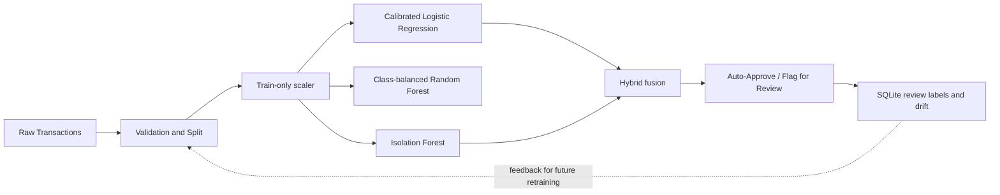

# Credit Card Fraud Detection

An interactive ML Systems project for B Yashwanth Sai (2520030036) and Dhanvin Gupta (2520030604). It compares calibrated Logistic Regression and a class-balanced Random Forest against Isolation Forest anomaly scores, and reports class-imbalance-aware metrics from a held-out test set. The backend reads the provided dataset at `backend/data/creditcard.csv`; it does not fabricate or download data.

## Architecture



The live prediction API uses the same fitted scaler artifact and feature order as training. This avoids training-serving skew caused by fitting or transforming features differently at inference time. Random Forest is evaluated as an additional supervised comparator and does not affect the hybrid decision. The fusion score is `w_lr * calibrated_probability + (1 - w_lr) * normalized_anomaly`. A transaction is flagged when either model crosses its validation-selected strong threshold, both cross their moderate thresholds, or hybrid risk crosses its threshold.

## Setup (Windows PowerShell)

```powershell
cd "C:\ML PROJECT"
cd backend
python -m venv .venv
.\.venv\Scripts\Activate.ps1
pip install -r requirements.txt
cd ..
npm install
npm --prefix frontend install
npm run train
npm run dev
```

Open <http://localhost:5173> for the dashboard and <http://localhost:8000/docs> for the API. You can also use **Run all** in VS Code Tasks. Add your CSV to `backend/data/creditcard.csv` before training. The local dataset is ignored by Git.

## Deploy to Render

The root `render.yaml` and `Dockerfile` deploy a single same-origin service on Render's free web plan. The image includes the trained model and aggregate EDA/model snapshots, so the 150 MB source CSV is not uploaded. Individual transaction examples are not packaged; the live scorer uses aggregate reference profiles when the CSV is absent. The SQLite review database is ephemeral on the free plan and resets when the service restarts or redeploys.

To deploy, push this repository to GitHub, sign in to Render, create a Blueprint from the repository, and apply `render.yaml`. Render builds the Docker image and reports the public service URL when deployment completes.

## Setup (macOS/Linux)

```bash
cd "/path/to/ML PROJECT/backend"
python3 -m venv .venv
source .venv/bin/activate
pip install -r requirements.txt
cd ..
npm install
npm --prefix frontend install
```

Run training with `cd backend && .venv/bin/python -m app.training`. For development, run `cd backend && .venv/bin/python -m uvicorn app.main:app --reload --port 8000` in one terminal and `npm --prefix frontend run dev` in another.

## API

| Method | Endpoint | Purpose |
|---|---|---|
| GET | `/api/health` | Dataset and model availability |
| GET | `/api/eda/summary` | Dataset profile and notebook summary statistics |
| GET | `/api/eda/charts` | Histograms, correlations, and KDE data |
| GET | `/api/models/metrics` | Test metrics and training metadata |
| GET | `/api/samples` | One real fraud and legitimate example |
| POST | `/api/predict` | Score and persist one transaction |
| POST | `/api/predict/batch` | Score a CSV (up to 50,000 rows) |
| GET | `/api/review/queue` | Flagged rows for analyst review |
| POST | `/api/review` | Record a fraud/legitimate verdict |
| GET | `/api/review/stats` | Pending and resolved review counts |
| GET | `/api/review/export` | Download analyst labels as CSV |
| GET | `/api/monitoring/drift` | PSI by feature for scored transactions |

If data is missing, the API still starts and the UI displays its required location. If models are missing, prediction endpoints return a 503 and explain how to train them.

## Retraining and evaluation

Run `npm run train` after placing the CSV. Training validates the exact feature layout, reports duplicates without dropping them, uses a stratified 70/15/15 split, fits the Time/Amount scaler on train only, tunes Logistic Regression and Isolation Forest using training/validation data, and fits a class-balanced Random Forest. It writes model artifacts plus `backend/models/metrics.json`, including feature importance and all model curves. Test metrics are calculated after validation-selected thresholding. PR-AUC is emphasized because fraud is rare; a high accuracy can hide missed fraud. Random Forest impurity importance ranks useful split features but is not causal or a per-transaction explanation. The hybrid is reported honestly even if it does not beat both individual models. Duplicate removal is not applied automatically.

## Viva cheat-sheet

1. **Why is accuracy misleading?** Fraud is roughly 0.17%; approving everything is highly accurate but catches no fraud.
2. **Why PR-AUC?** It shows the precision/recall trade-off for the rare positive class more clearly than ROC-AUC.
3. **Why calibrate Logistic Regression?** Calibration makes probabilities more interpretable as risk estimates.
4. **Why Isolation Forest?** It can surface unusual patterns without needing fraud labels for its fit.
5. **Why Random Forest?** Bagging and feature subsampling provide a non-linear supervised comparator for structured transactions.
6. **Why combine the models?** Supervised known patterns and unsupervised anomalies provide complementary signals.
7. **How are thresholds chosen?** On validation data only; the test split stays held out for final evaluation.
8. **How is leakage prevented?** The scaler is fit on training data only and reused for validation, test, and serving.
9. **How is drift monitored?** PSI compares scored transaction feature distributions with the reference data.
10. **What does human review add?** Analysts can label flagged transactions; labels are exportable for future training.
11. **What are the limitations?** The source data is historical and European, labels may be stale, and drift/threshold performance must be reviewed before production use.

## Current validation status

Test-set metrics and artifacts are generated by `python -m app.training`; they must be read from the generated `backend/models/metrics.json` rather than copied into source. The CSV is required to produce those computed values. Run `npm run test` and `npm --prefix frontend run build` after installing dependencies.

On the included dataset and current seed-42 split, Random Forest achieved PR-AUC 0.8266 and F1 0.8397; Logistic Regression achieved PR-AUC 0.7878 and F1 0.8406; Isolation Forest achieved PR-AUC 0.1721 and F1 0.2748; the hybrid achieved PR-AUC 0.7279 and F1 0.5673. Random Forest has the highest PR-AUC while Logistic Regression's F1 is slightly higher at the selected operating points. The hybrid catches one additional test fraud case versus Logistic Regression (59 vs. 58) but generates more false alarms. These are the backend-computed held-out test results, not illustrative slide values.
